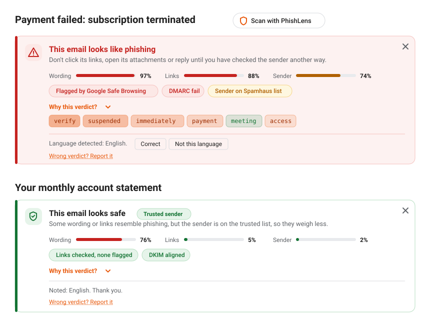
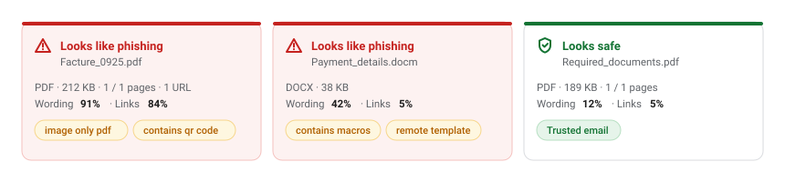
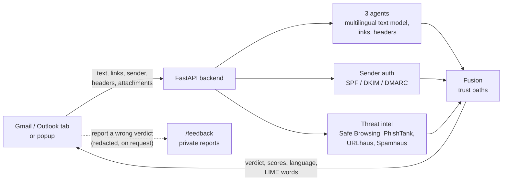
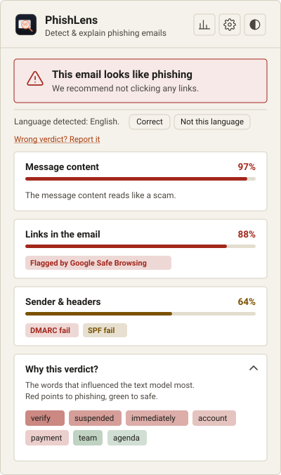

<div align="center">


# PhishLens

**Detect and explain phishing emails in real time, inside Gmail and Outlook.**

[](https://github.com/AnzouK/PhishLens/actions/workflows/ci.yml)
[](https://github.com/AnzouK/PhishLens/releases/latest)
[](LICENSE)
[](https://anzouk.duckdns.org)
[](https://huggingface.co/AnzouKiona/phishlens-distilbert)

<picture>
  <source media="(prefers-color-scheme: dark)" srcset="docs/gmail-verdicts-dark.svg">
  
</picture>

</div>

PhishLens is a Chrome extension and a FastAPI backend that classify an
email as safe or phishing and show why. Three agents score each message
(a multilingual transformer on the text, and two Random Forests on the
links and the headers), then the verdict is adjusted with real evidence:
SPF/DKIM/DMARC alignment and four threat-intelligence sources. A LIME
panel highlights the words that drove the decision. Attachments are
scanned too: PDFs (including scanned ones, through OCR), images, HTML
pages, Word / Excel / PowerPoint files, ZIP, RAR and 7z archives, calendar invites
and attached emails, with QR codes decoded and macros, executables,
password-protected archives and other dropper tricks flagged. The
scanner handles real-inbox cases: conversations, forwarded emails,
image-only emails and links hidden behind "Click here". The extension
and the website are available in English, French, Portuguese, Spanish,
German, Italian, Dutch and Hausa.

<div align="center">
  <picture>
    <source media="(prefers-color-scheme: dark)" srcset="docs/attachments-dark.svg">
    
  </picture>
  <br/>
  <sub><em>Attachment scan results under the attachment strip in Gmail.</em></sub>
</div>

## Results

**Detection** (held-out test sets; datasets and protocol in
[PhishingDetector](https://github.com/dodi-ctrl/PhishingDetector)):

| Agent | Model | Accuracy | F1 |
| --- | --- | --- | --- |
| Text (self-hosted default) | DistilBERT, fine-tuned on 29.5k emails | 97.34% | 0.967 |
| URL | Random Forest, 23 features | 99.34% | 0.991 |
| Metadata | Random Forest, 37 features | 99.92% | 0.999 |

PhishLens Cloud runs a multilingual text model (mmBERT-small, distilled
from a larger multilingual detector). On real mail no model saw during
training, with a 0.7 threshold, it raises false alarms on 0.4% of English
and 1.6% of French legitimate emails and catches 92.5% and 87.4% of
phishing. How it was built and measured:
[multilingual-model.md](docs/multilingual-model.md).

**Latency** on PhishLens Cloud with the English text model of v1.15
(Oracle Cloud ARM, 4 cores, CPU only,
[load test](docs/operations.md#load-testing) with 10 concurrent users):
`/analyse` median 77 ms, p95 280 ms, zero failures over 454 requests.

These are offline numbers. Real inboxes are harder; see the
[known limitations](docs/threat-model.md#residual-risks-and-known-limitations).

## How it works



The key idea: a text model alone flags real bank and university emails
because they use the same "verify your account" wording as phishing. So
the text score is discounted only when the sender is proven (DKIM aligned
with the From: domain) or curated, and a Safe Browsing hit on any link
forces "phishing" whoever the sender is. Details, diagrams and design
decisions: [docs/architecture.md](docs/architecture.md).

## Quickstart

**1. Load the extension.** Open `chrome://extensions`, turn on Developer
mode, click **Load unpacked** and pick the `extension/` folder.

**2. Pick a backend** in the extension's gear menu (PhishLens Cloud is
the default, so this step is optional):

| Option | Setup | When to use it |
| --- | --- | --- |
| PhishLens Cloud (default) | none | Normal use. Hosted server, nothing stored ([privacy policy](PRIVACY.md)). |
| Local Docker | commands below | Emails never leave your machine. |
| Local Python | commands below | Development. |

Local Docker:

```bash
mkdir -p backend/model
huggingface-cli download AnzouKiona/phishlens-distilbert --local-dir backend/model
cd backend && docker compose up --build
```

Local Python (3.12), with Tesseract installed for OCR (`brew install tesseract` or `apt install tesseract-ocr`):

```bash
cd backend
python3 -m venv .venv && source .venv/bin/activate
pip install torch --index-url https://download.pytorch.org/whl/cpu   # CPU build, not in requirements.txt
pip install -r requirements.txt
uvicorn extension_backend:app --host 127.0.0.1 --port 8000
```

The backend is ready when the logs show `Text model loaded from ...`, or when `/health` answers.

## Usage

- **In Gmail:** open an email and click **Scan with PhishLens** next to
  the subject. The verdict appears above the body with per-agent scores,
  sender-authentication chips and a "Why?" panel. Emails with attachments
  get a **Scan N attachments** button.
- **In the popup:** drop a `.eml` file or an attachment (PDF, image,
  Word, Excel, PowerPoint, HTML, ZIP, RAR, 7z, .ics), or paste the text of an email.
- **In Outlook on the web:** the same **Scan with PhishLens** button on
  an open email (manual scans).
- **History:** every scan is kept locally in the browser, with a small
  analytics view and CSV / JSON export.
- **Language:** Settings > Language; by default the browser's language.

The [user guide](https://github.com/AnzouK/PhishLens/wiki) covers each
of these step by step.

<div align="center">
  <picture>
    <source media="(prefers-color-scheme: dark)" srcset="docs/popup-dark.svg">
    
  </picture>
</div>

## Configuration

The backend is configured with environment variables. The most useful:

| Variable | Default | Purpose |
| --- | --- | --- |
| `GSB_API_KEY` | empty | Google Safe Browsing key; that tier is off without it |
| `REPUTATION_ENABLE_GSB` / `_PHISHTANK` / `_URLHAUS` / `_DBL` | `1` | Turn each threat-intel source on or off |
| `REPUTATION_CACHE_DB` | `~/.cache/phishlens/reputation.db` | SQLite cache for URL verdicts (24 h TTL) |
| `RATE_LIMIT_ANALYSE` | `30/minute` | Per-IP limit (also `RATE_LIMIT_ATTACHMENT`, `RATE_LIMIT_EXPLAIN`) |
| `LIME_NUM_SAMPLES` | `100` | Forward passes per explanation: higher is sharper and slower |
| `OCR_MAX_PAGES` / `OCR_TIMEOUT_S` | `3` / `10` | Pages of a scanned PDF sent to OCR, and the time limit per page |
| `AGENTS_ALLOW_PICKLE` | `1` | Set to `0` once the `.skops` agents are published, to refuse pickle files |
| `MODEL_DIR` / `HF_MODEL_REPO` | `./model` / `AnzouKiona/phishlens-distilbert` | Where the text model is stored, and which Hugging Face repository it comes from ([switching models](docs/operations.md#switch-the-text-model)) |
| `HF_TOKEN` | empty | Read-only token, only for a private model repository |
| `OCR_LANG` | `auto` | Tesseract languages; `auto` picks them from the script of each image |
| `FEEDBACK_DIR` / `RATE_LIMIT_FEEDBACK` | empty / `20/hour` | Where reports sent from the extension are stored (empty: not collected) |
| `FEEDBACK_NOTIFY_URL` | empty | `https://` address that receives a one-line message for each new report, for example an [ntfy](https://ntfy.sh) topic; never the report's text |
| `METRICS_ENABLED` | `1` | Prometheus metrics on `/metrics` (keep it private) |
| `LOG_LEVEL` | `INFO` | Log level for the `phishlens.*` loggers |

The full list, deployment steps and monitoring are in
[docs/operations.md](docs/operations.md). Scoring weights and the trusted
sender list are explained in
[docs/architecture.md](docs/architecture.md#scoring-reference).

## Project layout

```
backend/               FastAPI app, agents, sender auth, threat intel, attachments
  extension_backend.py   HTTP API (endpoints, limits, metrics)
  settings.py            version, environment, scoring constants
  email_parsing.py       text, links and headers of an email
  sender_trust.py        sender domain, allowlist, Gmail auth hints
  text_model.py          text agent and LIME
  structured_agents.py   URL and metadata agents
  fusion.py              scores to verdict (pure functions)
  auth_headers.py        SPF / DKIM / DMARC and Spamhaus DBL
  reputation.py          threat-intel cascade with SQLite cache
  attachment_analysis.py attachment dispatcher (PDF, HTML, text)
  ocr.py                 OCR for images and scanned PDFs, QR decoding
  office_analysis.py     Word / Excel / PowerPoint: text, links, macros
  agent_io.py            loads the Random Forests without pickle (skops)
  tests/                 offline pytest suite
extension/             Chrome MV3 extension (plain JS, no build step)
tests/                 extension unit tests (node:test), popup and website UI tests (Playwright)
site/                  website, built in 8 languages (do not edit by hand)
site-src/              its template, texts and translated legal pages
docs/                  architecture, threat model, operations, overview
scripts/locustfile.py  load test
```

## Documentation

Start with the [project overview](docs/project-overview.md): it links
both repositories, the models, the report and every guide.

| Document | Contents |
| --- | --- |
| [User guide (wiki)](https://github.com/AnzouK/PhishLens/wiki) | Install, use in Gmail and Outlook, read a verdict, settings, troubleshooting |
| [Architecture](docs/architecture.md) | Components, request flow, trust paths, text model, design decisions |
| [Languages](docs/languages.md) | Interface and website translations, OCR languages, text model languages |
| [Multilingual model](docs/multilingual-model.md) | How the 2.0 text model was trained and measured, round by round |
| [Threat model](docs/threat-model.md) | STRIDE analysis, mitigations, residual risks |
| [Operations](docs/operations.md) | Deploy, switch the text model, logs, metrics, load testing, backups |
| [Changelog](CHANGELOG.md) | What changed in each version |
| [Contributing](CONTRIBUTING.md) | Setup, checks, guidelines |
| [Security policy](SECURITY.md) | How to report a vulnerability |
| [Privacy policy](PRIVACY.md) | What data is handled, where it goes, what is kept |
| [Terms of use](TERMS.md) | Acceptable use, no-guarantee notice, liability |

## Roadmap

- **Chrome Web Store release** once the extension UI is final.
- **Outlook on the web:** manual scans work (v1.15); next, attachments,
  full headers and automatic scanning there, then Yahoo Mail.
- **Live evaluation at scale:** the review buttons and
  `scripts/live_eval.py` are in place; the next step is a few hundred
  reviewed real emails, plus phishing reported after the training
  cut-off.
- **Multilingual detection:** a version of the multilingual text model
  trained only on public data, so that it can be published, and a native
  review of the Hausa translation.
- **Research:** SHAP as a comparison for LIME, retraining the agents on
  OCR text and QR-code phishing.

## Origin

PhishLens started as a final-year project for a B.Sc. in Cybersecurity at
[Nile University of Nigeria](https://nileuniversity.edu.ng/) (2025/2026)
and is now maintained independently. The training and evaluation of the
original models live in the companion repository
[PhishingDetector](https://github.com/dodi-ctrl/PhishingDetector). The
accompanying paper describes PhishLens as it was when it was written;
everything added since is in the [CHANGELOG](CHANGELOG.md).

## Credits

PhishLens builds on the work and data of others:

- **Threat intelligence:** [Google Safe Browsing](https://safebrowsing.google.com/)
  (Safe Browsing warnings are advisories provided by Google),
  [PhishTank](https://phishtank.org/), [URLhaus](https://urlhaus.abuse.ch/)
  by abuse.ch and the [Spamhaus](https://www.spamhaus.org/) Domain Block List.
- **Models and libraries:** [Hugging Face Transformers](https://github.com/huggingface/transformers),
  [mmBERT](https://huggingface.co/jhu-clsp/mmBERT-small) and the
  [phishing-scam-detector](https://huggingface.co/Horizon-Labs/phishing-scam-detector-base)
  it was distilled from, DistilBERT, [scikit-learn](https://scikit-learn.org/),
  [LIME](https://github.com/marcotcr/lime),
  [Tesseract OCR](https://github.com/tesseract-ocr/tesseract) and
  [FastAPI](https://fastapi.tiangolo.com/); the full list of backend
  dependencies is in [`backend/requirements.txt`](backend/requirements.txt).
- **Training data:** the public phishing and legitimate email datasets
  listed in [PhishingDetector](https://github.com/dodi-ctrl/PhishingDetector),
  each under its own license.

## License

[GNU AGPL-3.0](LICENSE). Versions up to 1.15.5 were released under the MIT
license and stay available under it. From 2.0, anyone may use, study,
modify and share PhishLens, but a modified version, including one offered
as an online service, must be published under the same license.

The text model weights are licensed separately (CC BY-NC 4.0, see the
model card), because some of their training data is non-commercial.
