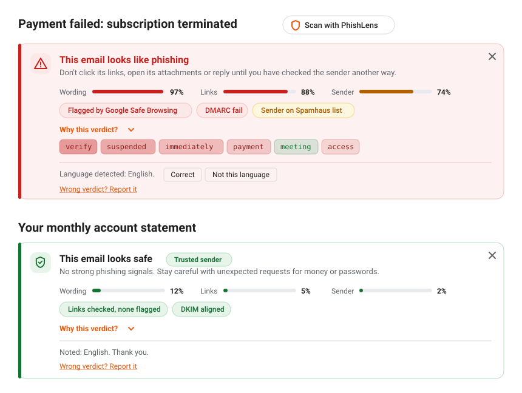
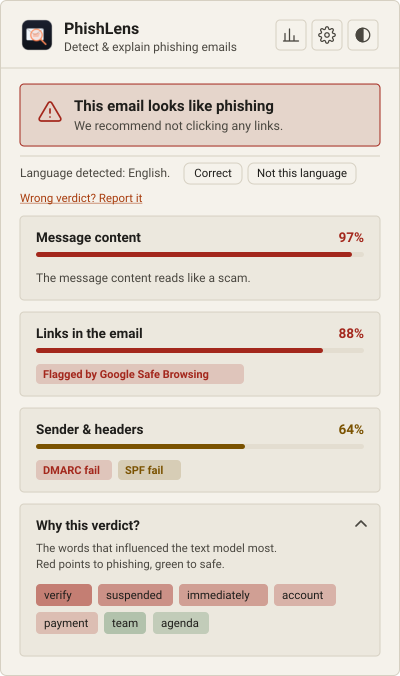

<div align="center">


# PhishLens

**Detect and explain phishing emails in real time, inside Gmail and Outlook.**

[](https://github.com/AnzouK/PhishLens/actions/workflows/ci.yml)
[](https://github.com/AnzouK/PhishLens/releases/latest)
[](LICENSE)
[](https://phishlens.dev)
[](docs/multilingual-model.md)

<picture>
  <source media="(prefers-color-scheme: dark)" srcset="docs/gmail-verdicts-dark.svg">
  
</picture>

</div>

PhishLens is a Chrome extension that checks an email in Gmail or Outlook
and tells you whether it looks like phishing, and why. It points to the
words, the links, whether the sender is who it claims to be, and what
the attachments contain. It is free, open source and available in
English, French, Portuguese, Spanish, German, Italian, Dutch and Hausa.

PhishLens does not filter your mail. It gives a verdict with its reasons
so that you can decide, and it can be wrong.

## What it checks

A multilingual text model scores the wording, and LIME shows the words
that weighed most. Every real link target, including the one behind
"Click here", is looked up in Google Safe Browsing, PhishTank, URLhaus
and Spamhaus and scored by a link model. For the sender, PhishLens reads
SPF, DKIM and DMARC from Gmail's original headers and checks whether the
name shown ("Chronopost", "PayPal") matches the address. Outlook gives
the page only the visible text, so the SPF, DKIM and DMARC results are
read in Gmail only. Attachments are opened too: PDFs (scanned ones
through OCR), images, QR codes, Office files and their macros, archives
and calendar invites.

The text score alone would flag real bank and university emails, because
they use the same words as phishing. PhishLens lowers it only when the
sender is proven (DKIM aligned with the From: domain), and a link known
to be malicious makes the verdict "phishing" whoever sent it. The
[architecture notes](docs/architecture.md) explain how the checks are
combined.

## Privacy

To check an email, PhishLens sends its text, links and headers (and the
attachment, if you scan one) to a server. By default that server is
**PhishLens Cloud**, which the author runs on Google Cloud Run in
Belgium, reached through `phishlens.dev` on Cloudflare.

- The email is analysed in memory and **not stored**. Only the result is
  kept, for 24 hours, keyed by a hash of the email, so that a second
  scan answers at once.
- Threat-intelligence services receive the **link addresses only**.
- Your scan history stays **in your browser**.
- Nothing else leaves your browser unless you choose to **report a wrong
  verdict**. You then see the redacted text, and can edit it, before it
  is sent.

If you would rather no email leave your computer, run the backend
yourself (below) and pick **Local** in the settings. The full details
are in the [privacy policy](PRIVACY.md).

## How good is it?

These figures come from real mail that no model saw during training,
scored by PhishLens Cloud's text model at its 0.7 threshold.

| Language | Legitimate emails flagged | Phishing caught |
| --- | --- | --- |
| English | 1 of 255, 0.4% (95% CI 0.1% to 2.2%) | 1,805 of 1,952, 92.5% (91.2% to 93.6%) |
| French | 1 of 63, 1.6% (0.3% to 8.5%) | 202 of 231, 87.4% (82.6% to 91.1%) |

The intervals show how much these counts can tell. With one false alarm
in 63 French emails, the true rate could be anywhere from 0.3% to 8.5%.
The legitimate emails all come from one mailbox and the phishing from
recent public collections (Nazario 2025, phishing_pot 2026), so another
inbox may see more false alarms. The model was trained on 22 languages
but tested on real phishing only in English, French, German, Dutch,
Portuguese and Spanish, and its score is less proven in the others. The
link, sender and threat-intelligence checks do not depend on the
language.

How the model was built and measured is described in
[multilingual-model.md](docs/multilingual-model.md), and what can go
wrong in the [known limitations](docs/threat-model.md#residual-risks-and-known-limitations).
You can measure it yourself with the public benchmark in
[evaluation.md](docs/evaluation.md).

The same benchmark measured the whole system (PhishLens Cloud, November
1, 2026) on real mail sent in 2026:

| Mail | Result |
| --- | --- |
| Phishing nobody looked at while tuning (phishing_pot, Nazario) | 1,804 of 2,000 caught, 90.2% (95% CI 88.8% to 91.4%) |
| Legitimate, public Apache mailing lists (used while tuning) | 1 of 297 flagged, 0.3% (0.1% to 1.9%) |
| Legitimate, real personal inboxes (bank, university and service notifications), received after the model's training mail | 0 of 117 flagged, 0.0% (0.0% to 3.2%) |

English (81.6%) and French (87.2%) are the weakest languages, and some
phishing sent from the attacker's own DKIM-signed domain still gets
through. The runs, their causes and what was rejected are listed in
[evaluation.md](docs/evaluation.md#results).

A scan of a typical email (about 250 tokens) takes about 190 ms on the
server (median, CPU only) and a short one about 65 ms, plus the
threat-intelligence lookups.

## Install

PhishLens is not on the Chrome Web Store yet.

1. Download `PhishLens-extension-<version>.zip` from the
   [latest release](https://github.com/AnzouK/PhishLens/releases/latest)
   and unzip it.
2. Open `chrome://extensions`, turn on **Developer mode** and click
   **Load unpacked** on the unzipped folder.
3. Open an email in Gmail or Outlook on the web and click **Scan with
   PhishLens** next to the subject. You can also drop a `.eml` file or an
   attachment, or paste text, in the popup.

The [user guide](https://github.com/AnzouK/PhishLens/wiki) goes through
each step in more detail.

<div align="center">
  <picture>
    <source media="(prefers-color-scheme: dark)" srcset="docs/popup-dark.svg">
    
  </picture>
</div>

### Run your own server

```bash
mkdir -p backend/model
# the public English text model; PhishLens Cloud runs the multilingual one
huggingface-cli download AnzouKiona/phishlens-distilbert --local-dir backend/model
cd backend && docker compose up --build
```

Then pick **Local** in the extension settings. A self-hosted server uses
the English text model by default. The multilingual model is private
because part of its training mail is. Configuration, deployment and
monitoring are covered in the [operations guide](docs/operations.md).

### Source and tests

The release zip holds only what Chrome loads. The extension is plain
JavaScript with no build step, so `extension/` in this repository is the
same code, with its tests and lint configuration next to it.

```bash
node --test tests/extension/*.test.js                      # unit tests, no dependency
npx eslint . --max-warnings 0                              # eslint.config.mjs
npx playwright test --config tests/ui/playwright.config.js # popup and website
```

CI runs all three on every pull request. See the
[contributing guide](CONTRIBUTING.md) for setup and the project layout.

## Documentation

| Document | Contents |
| --- | --- |
| [User guide (wiki)](https://github.com/AnzouK/PhishLens/wiki) | Install, Gmail and Outlook, reading a verdict, settings, troubleshooting |
| [Architecture](docs/architecture.md) | Components, scoring, trust paths, design decisions |
| [Multilingual model](docs/multilingual-model.md) | How the text model was trained and measured |
| [Evaluation](docs/evaluation.md) | What is measured, confidence intervals, and a public benchmark you can run |
| [Languages](docs/languages.md) | Translations, OCR languages, adding a language |
| [Threat model](docs/threat-model.md) | Risks, mitigations, known limitations |
| [Operations](docs/operations.md) | Deployment, configuration, logs, metrics, load testing |
| [Contributing](CONTRIBUTING.md) | Setup, project layout, checks |
| [Changelog](CHANGELOG.md), [Security](SECURITY.md), [Privacy](PRIVACY.md), [Terms](TERMS.md) | |

## Roadmap

- Attachments, full headers and automatic scanning in Outlook, through
  Microsoft's mail API.
- Yahoo Mail.
- For measurement and research, more reviewed real emails and the
  reports users send, SHAP next to LIME, and retraining on OCR text and
  QR-code phishing.
- A multilingual model trained only on public data, so that it can be
  published. A native review of the Hausa translation is under way.
- A Chrome Web Store release.

## Who makes it

PhishLens is built and run by one person, [AnzouK](https://github.com/AnzouK).
It began as our group's final-year project at
[Nile University of Nigeria](https://nileuniversity.edu.ng/). Of the
topics we considered, we chose a phishing detector that explains its
verdict instead of only flagging an email. The team trained the first
three models in [PhishingDetector](https://github.com/dodi-ctrl/PhishingDetector)
(maintained by [dodi-ctrl](https://github.com/dodi-ctrl)). When the
course ended I kept it going on my own, and it is now an independent
project with no link to the university.

I write it with the help of an AI coding assistant. I review and test
every change, and no claim about detection ships before it is measured
on the public benchmark. The worst run so far (130 of 297 legitimate
emails flagged in mid-October) and what fixed it are described in
[evaluation.md](docs/evaluation.md#results).

## Credits

PhishLens builds on [Google Safe Browsing](https://safebrowsing.google.com/)
(its warnings are advisories provided by Google),
[PhishTank](https://phishtank.org/), [URLhaus](https://urlhaus.abuse.ch/)
by abuse.ch, the [Spamhaus](https://www.spamhaus.org/) Domain Block List,
[Hugging Face Transformers](https://github.com/huggingface/transformers),
[mmBERT](https://huggingface.co/jhu-clsp/mmBERT-small) and the
[phishing-scam-detector](https://huggingface.co/Horizon-Labs/phishing-scam-detector-base)
it was distilled from, DistilBERT, [scikit-learn](https://scikit-learn.org/),
[LIME](https://github.com/marcotcr/lime),
[Tesseract](https://github.com/tesseract-ocr/tesseract),
[FastAPI](https://fastapi.tiangolo.com/), and the public email datasets
listed in PhishingDetector and in the [model documentation](docs/multilingual-model.md#sources).

## License

PhishLens is released under the [GNU AGPL-3.0](LICENSE). Anyone may use,
study, modify and share it, and a modified version, including one
offered as an online service, must be published under the same license.
Versions up to 1.15.5 were released under the MIT license. The text
model weights are licensed separately (CC BY-NC 4.0), because some of
their training data is non-commercial.
