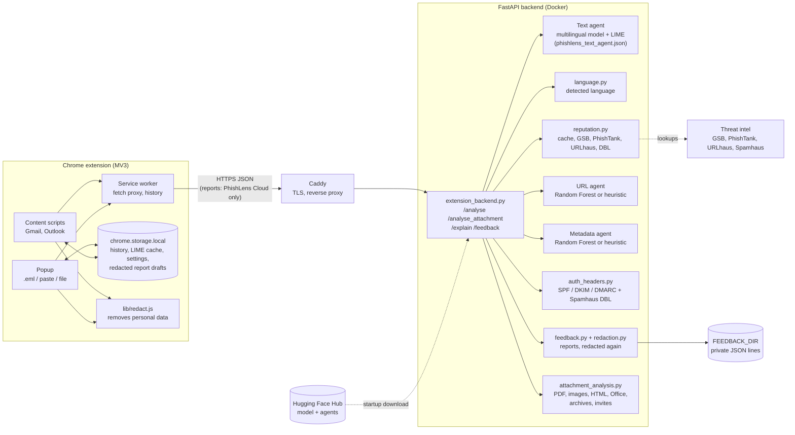
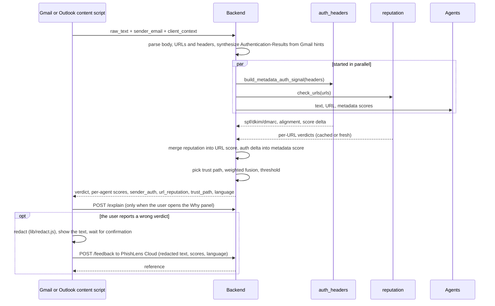
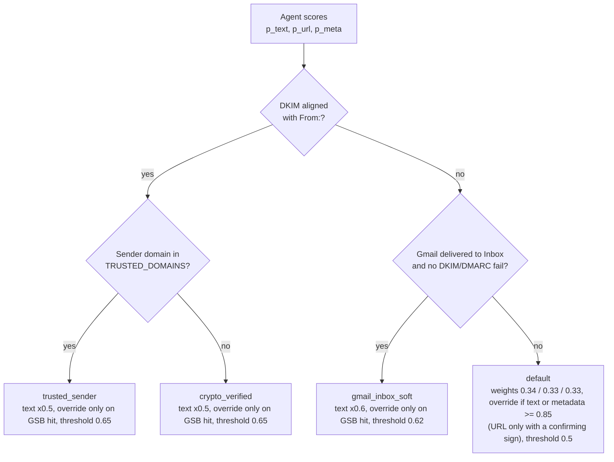
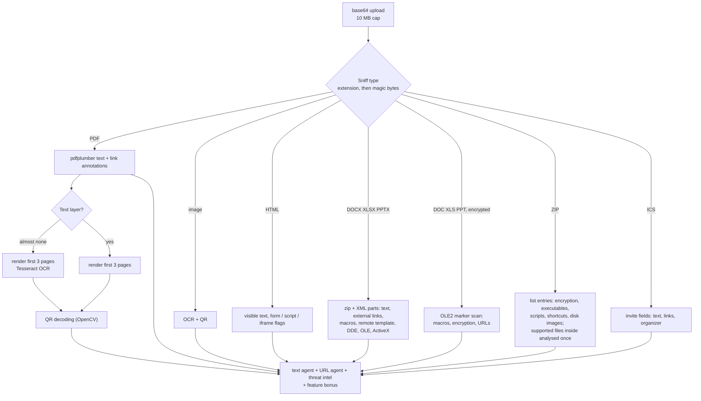

# Architecture

PhishLens has two runtime parts: a Chrome MV3 extension that lives inside
Gmail and Outlook on the web, and a FastAPI backend that does all the
scoring. The extension
never classifies anything itself; it collects what it can see (body text,
sender, Gmail's own authentication hints, attachments) and renders the
backend's answer.

## Components

| Module | Responsibility |
| --- | --- |
| `extension/content_scripts/core.js` | Shared state of the content scripts: options, observers, text and link extraction, message passing to the service worker |
| `extension/content_scripts/banner.js` | The verdict banner, its chips and the "Why?" panel (Gmail and Outlook) |
| `extension/content_scripts/gmail_scan.js` | Gmail: scan buttons, reading the open email, "Show original" headers, `mailed-by` / `signed-by` |
| `extension/content_scripts/attachments.js` | Gmail: attachment buttons, download and scan, attachment results |
| `extension/content_scripts/autoscan.js` | Gmail: optional automatic scan of unread mail, list badges, notifications |
| `extension/content_scripts/gmail.js` | Gmail: starts the observers (loaded last) |
| `extension/content_scripts/outlook.js` | Outlook on the web: scan button and reading the open email |
| `extension/background.js` | Proxies requests to the backend (the mail pages' CSP blocks direct fetches), saves scans to the history, notifications |
| `extension/lib/shared.js` | Backend choice, HTML escaping and API error messages, shared by every view |
| `extension/lib/i18n.js`, `locales/` | Interface texts in 8 languages (see [languages.md](languages.md)) |
| `extension/lib/history.js`, `lime_cache.js` | Local scan history and analytics; SHA-256 keyed LIME cache |
| `backend/extension_backend.py` | HTTP API only: endpoints, request limits, rate limiting, metrics, result cache, error references |
| `backend/settings.py` | Version, environment variables, every scoring constant (weights, thresholds, trust paths) |
| `backend/email_parsing.py` | Visible text, links and headers of an email; forwarded emails; links to file-sharing services |
| `backend/sender_trust.py`, `trusted_domains.py`, `known_domains.py` | Sender domain, allowlist (authenticated senders only), brand impersonation, Gmail "signed-by" / "mailed-by" as an Authentication-Results header; known brands, sites and cloud file hosts |
| `backend/text_model.py`, `text_normalize.py` | Text agent: loading the model and its settings, calibrated scores, LIME explanation; text normalisation for models trained on normalised text |
| `backend/structured_agents.py`, `rf_agent.py`, `url_agent.py`, `metadata_agent.py` | URL and metadata agents: trained Random Forests with rule-based fallbacks |
| `backend/agent_io.py` | Loads the Random Forests from skops files with a type allowlist |
| `backend/fusion.py` | Agent scores and evidence to a verdict, for emails and attachments (pure functions) |
| `backend/auth_headers.py` | RFC 7489 parsing of `Authentication-Results`, organisational-domain alignment, Spamhaus DBL on the From: domain |
| `backend/reputation.py` | URL reputation cascade with a SQLite cache and a daily Google Safe Browsing quota |
| `backend/result_cache.py` | 24-hour in-memory cache of results, keyed by a hash of the request |
| `backend/language.py` | Language of an email (writing system, then common words), returned as `language` by `/analyse` and `/analyse_attachment` |
| `backend/feedback.py`, `redaction.py` | `POST /feedback`: reports users choose to send, redacted again and stored as JSON lines (see below) |
| `extension/lib/redact.js`, `report_ui.js`, `content_scripts/feedback.js` | Redaction before anything is shared; the language line and the report panel under each verdict |
| `backend/attachment_analysis.py` | MIME sniffing, PDF, image and HTML extraction, risky-feature flags, dispatch to the modules below |
| `backend/office_analysis.py`, `archive_analysis.py`, `ocr.py` | Word / Excel / PowerPoint, ZIP / RAR / 7z, OCR (multilingual) and QR decoding |
| `backend/feature_extraction.py` | Feature engineering shared with the training repo (the Random Forests depend on its exact output) |

## Request flow: `POST /analyse`

The LIME explanation is a separate call because it costs about 100 forward
passes. The verdict shows in a few seconds and the explanation streams in
afterwards; the extension caches it so reopening the same email is instant.

## Scoring and trust paths

Before the paths apply, two external signals are folded in: a Google Safe
Browsing hit lifts the URL score to at least 0.95, a hit from another
intel source blends into it, and the SPF/DKIM/DMARC result shifts the
metadata score (down by up to 0.3 for an aligned, fully passing sender;
up for each failure and by 0.6 for a Spamhaus-listed domain, clamped to
the 0 to 1 range). The chosen path is returned as
`trust_path` in the response and counted in the `phishlens_verdicts_total`
metric.

### Scoring reference

Base weights on the default path (constants in `settings.py`):

| Knob | Value |
| --- | --- |
| `W_TEXT` / `W_URL` / `W_META` | 0.34 / 0.33 / 0.33 |
| `PATH_DEFAULT.threshold` | 0.5 |
| `HIGH_CONF_OVERRIDE` (any single agent) | 0.85 |

How each trust path changes them:

| Path | Text weight | Single-agent override | Threshold | Extra |
| --- | --- | --- | --- | --- |
| `trusted_sender` | x0.5 | only on a Safe Browsing hit | 0.65 | authenticated sender only; metadata score capped at 0.05 |
| `crypto_verified` | x0.5 | only on a Safe Browsing hit | 0.65 | |
| `gmail_inbox_soft` | x0.6 | only on a Safe Browsing hit | 0.62 | |
| `outlook_internal` | x0.6 | only on a Safe Browsing hit | 0.62 | Outlook sender from the user's own organisation (address hidden by Outlook, mail authenticated by the organisation's server); the organisation's domain is used for the allowlist check, so an allowlisted organisation gets `trusted_sender` instead |
| `default` | x1.0 | text or metadata >= 0.85; URL >= 0.85 only with a concrete sign (threat-intel hit, raw IP, plain http, `@`, suspicious TLD) | 0.5 | |

A Google Safe Browsing match on any link forces the phishing verdict on
every path: a trusted or signed sender carrying a blocklisted link means
the sending account is compromised.

**Precedence:** `trusted_sender > crypto_verified > gmail_inbox_soft >
default`. The allowlist (`TRUSTED_DOMAINS`) only applies to an
authenticated sender: DKIM aligned with the From: domain (real headers
or Gmail's "signed-by"), or internal Outlook mail authenticated by the
organisation's own server. Until v1.15 the From: text alone was enough,
so a forged bank address got the softest path (fixed in v2.0). It covers
Nigerian institutions and large European and international senders;
extend it for your region. An empty allowlist is safe.

**Impersonation (v2.0.7):** when the From: name is a known brand
("Chronopost", "La Poste", "PayPal", `known_domains.BRANDS`) and the
address belongs to another domain, the email loses every softer path
(DKIM on the impostor's own domain proves nothing about the brand) and
the sender score is at least `IMPERSONATION_META` (0.9), which decides
the verdict on the default path. The extension sends the name it shows
(`sender_name`) with the address; `sender_auth.impersonation` names the
brand and the domain.

**Forwarded emails (v1.14):** when the body carries a forward marker
("Forwarded message", "Begin forwarded message:", "Message transféré",
...) or the subject starts with Fwd:/TR:, the sender only vouches for
the forward, not for the content. The allowlist, DKIM and Gmail-inbox
discounts are then switched off (default path), and the original sender
found in the forwarded block is returned in `forwarded`.

**Near-empty bodies (v1.14):** with fewer than 3 words (image-only
emails, a bare link) the text agent is left out: the URL and metadata
scores share the whole weight, and a confident text score cannot fire
the override. `text_agent_used` says which case applied.

**Link targets and shared files (v1.14):** the Gmail extension sends the
real `href` of every link in `client_context.link_urls` (the visible
text of "Click here" has no URL), so hidden links reach the URL agent
and the threat-intel cascade. Links to file-sharing and form services
(Google Drive / Docs / Forms, OneDrive, SharePoint, Dropbox, WeTransfer,
...) are listed in `shared_links` and shown as a warning, without
changing the score: the domain is legitimate, the shared file is the
lure.

**Cloud file hosts and known sites (v2.0.7):** a link to storage or a
page anyone can publish (`storage.googleapis.com`, `*.web.app`,
`*.r2.dev`, IPFS gateways...) adds 0.45 to the link rule score, enough to
confirm a high URL score. Links that only go to large known sites
(`known_domains.WELL_KNOWN`, without an embedded second address) keep the
rule score instead of the trained URL model, which reads their long
tracking links as phishing.

**Sender not checked (v2.0.7):** without headers (pasted text with no
sender), `agents.metadata.checked` is false and the interfaces show "not
checked" instead of the neutral default score.

**Why the discounts exist:** DistilBERT learned that "verify your
account" wording means phishing, and real bank, hospital and university
messages use the same templates. Discounting the text agent only when the
sender is proven (DKIM, plus the allowlist for authenticated senders) removes those false
positives without trusting whatever the From: header claims.

Attachments (`/analyse_attachment`) use a simpler rule: text and URL
agents at 0.5 each, plus a bonus for risky features (password field, PDF
auto-execute, and so on, capped at 0.7), threshold 0.55. If the parent
email was trusted, the text weight is halved and the threshold rises to
0.72, but a Safe Browsing hit still forces phishing.

### Attachment pipeline

| Flag | Bonus | Why it matters |
| --- | --- | --- |
| `contains_macros` | 0.45 | VBA or Excel 4.0 macros, the classic dropper |
| `remote_template` | 0.45 | Template fetched from a URL at open time (template injection) |
| `dde_field` | 0.40 | DDE field that can launch a command |
| `launch_external_action`, `auto_execute_on_open` | 0.35, 0.30 | PDF actions that run on open |
| `contains_password_field` | 0.40 | An HTML login page as an attachment is almost always phishing |
| `encrypted_document` | 0.30 | Password in the email body blinds scanners |
| `contains_activex` | 0.25 | ActiveX control in an Office file |
| `contains_qr_code` | 0.20 | "Quishing": the link is hidden from text scanners |
| `embedded_ole_object`, `external_data_connection` | 0.20 | Hidden payloads or remote data |
| `image_only_pdf` | 0.10 | No text layer: an evasion trick, but real scans exist too |
| `legacy_office_format` | 0.10 | Pre-2007 binary format |
| `disk_image_attachment`, `disk_image_in_archive` | 0.40 | ISO / IMG / VHD mount as a drive and skip the "downloaded file" warning |
| `encrypted_archive` | 0.35 | Password-protected ZIP, RAR or 7z: scanners cannot open it |
| `zip_bomb_suspected` | 0.30 | Compression ratio above 100 |
| `uninspectable_archive` | 0.20 | RAR / 7z the server cannot open (damaged, multi-volume, library missing) |
| `inner_files_not_extracted` | 0.10 | RAR listed but its members could not be decompressed |
| `nested_archive`, `calendar_with_links` | 0.10 | Archive in an archive; invite carrying links |

Macros, remote templates and DDE fields force the phishing verdict on
every path, and so (v1.14) do executables, scripts and shortcut files
(`.exe`, `.js`, `.lnk`, ...) attached directly or inside a ZIP, RAR or 7z archive, and
double extensions such as `invoice.pdf.exe`. They force the verdict even when the parent email is trusted: Gmail delivering the
email says nothing about what a macro does once enabled, and hijacked
accounts are how these documents usually travel.

Every step has a resource limit: 10 MB per upload, 3 OCR pages, a
10 s Tesseract timeout per page, images downscaled to 3000 px, a
decompression-bomb guard, and for Office files a cap on part count,
total uncompressed size (zip bombs) and part size. XML parts that
declare a DOCTYPE are skipped rather than parsed.

## Text model

The text agent is any Hugging Face sequence-classification checkpoint
with two labels (safe, phishing). `HF_MODEL_REPO` names it; each
repository is downloaded into its own folder,
`MODEL_DIR/<owner>--<name>`, so switching repositories never loads the
previous model by mistake (a private repository needs a read-only
`HF_TOKEN`). The original DistilBERT may also sit directly in
`MODEL_DIR`, as earlier versions expected.

How the backend feeds the model and reads its output is described next
to the weights, in `phishlens_text_agent.json`, so a new model needs no
code change:

| Key | Default | Meaning |
| --- | --- | --- |
| `normalize` | `false` | Run `text_normalize.normalize_text` first (masks URLs, email addresses and phone numbers the way the training data was masked) |
| `max_length` | `256` | Tokens kept |
| `temperature` | `1.0` | Calibration: scores are `softmax(logits / T)`; a `calibration.json` from the training code is read too |
| `override_threshold` | `HIGH_CONF_OVERRIDE` (0.85) | Text score from which the text agent alone can force a phishing verdict on the default path; a calibrated model gives confident scores more often, so it needs its own threshold |
| `name`, `version` | repository id | Shown by `/health` and by "Test connection" in the extension |

`GET /health` returns the version of the server and a `text_model` object
with the repository, the name and these settings, so anyone can check
which model answers.

## Reports from users

Under each verdict the extension shows the detected language
(**Correct** / **Not this language**, stored in the local history) and
**Wrong verdict? Report it**. A report is built in the browser:
`lib/redact.js` removes names after a greeting or a title, the user's own
name and address read from the mail page, email addresses, phone numbers,
long numbers, IBANs, handles and usernames, and the path of every link
(the domain stays). The person sees the result in an editable text box
and must tick a confirmation before **Send**. Insights can also share the
reviewed history as statistics (no subject, sender or text).

Reports always go to PhishLens Cloud (`background.js`), whatever server
does the scanning. `POST /feedback` validates them (kinds, lengths,
language codes), runs the same redaction again (`redaction.py`, checked
against the same cases as the JavaScript: `tests/fixtures/redaction_cases.json`),
and appends them to `FEEDBACK_DIR/feedback-YYYY-MM.jsonl` with a random
reference and the day only: no IP address or headers. The endpoint is
off (503) when `FEEDBACK_DIR` is empty, rate-limited (`RATE_LIMIT_FEEDBACK`)
and refuses new reports once the folder reaches `FEEDBACK_MAX_MB`.
Reports are training material only after a human has read them.

## Key design decisions

**DistilBERT rather than BERT-base.** About 40% smaller and 60% faster for
a few points of accuracy. The public demo runs on a CPU-only ARM VM, and
the extension needs a verdict in seconds, not tens of seconds. The same
constraint applies to any replacement: small encoders, scores calibrated
on held-out data, described by `phishlens_text_agent.json`.

**Interface translations without `chrome.i18n`.** Chrome's own
mechanism only covers the languages Chrome supports, which leaves out
Hausa. A small dictionary loader shared by every view does the job, with
tests that keep the eight languages in step ([languages.md](languages.md)).

**Three agents plus fusion rather than one bigger model.** Text, URLs and
headers fail in different ways. Separate agents keep each one small,
explainable, and replaceable (the URL and metadata agents fall back to
heuristics when the trained models are unavailable), and the per-agent
scores are shown to the user.

**Cryptographic sender checks over a pure allowlist.** An allowlist alone
trusts whatever the From: header claims. DKIM alignment proves the sender
domain, so a spoofed `From: paypal.com` signed by another domain stays on
the strict path. The allowlist only adds to an authenticated sender: it
never replaces the authentication.

**Gmail's own verdict as a soft signal.** When the extension cannot read
the headers, the fact that Gmail delivered the message to Inbox (after its
own SPF/DKIM/DMARC checks) is used as a weak trust hint. It only softens
the text weight; it never overrides threat intelligence.

**Threat-intel cascade ordered by quality and cost.** Local cache first
(free), then Google Safe Browsing (best coverage, 10k/day quota tracked
in process), then PhishTank, URLhaus and Spamhaus DBL (free, weaker
coverage). Lookups run in parallel with model inference so they add
almost no latency.

**LIME on demand, cached client side.** Explanations are the slowest
operation. Making them a second request keeps verdicts fast, and the
SHA-256 keyed cache turns a repeat explanation into a local read.

**Two repositories.** Training code and notebooks change rarely and pull
heavy dependencies; the runtime should stay small and installable. The
models are the contract between the two, published on Hugging Face.

**Office parsing with the standard library.** Word, Excel and PowerPoint
files are read as ZIP + XML with `zipfile` and `ElementTree`, not with
python-docx or openpyxl: nothing to install, nothing that interprets
document content, and full control over size limits.

**Random Forests in the skops format.** Pickle (joblib) runs arbitrary
code when loaded. skops stores the same scikit-learn objects as data,
and the loader refuses any file that references a type outside
scikit-learn, NumPy, SciPy or the Python builtins.

**No accounts, no server-side storage of emails.** The backend is
stateless apart from the URL reputation cache (URLs and verdicts only).
Scan history lives in the user's browser.
