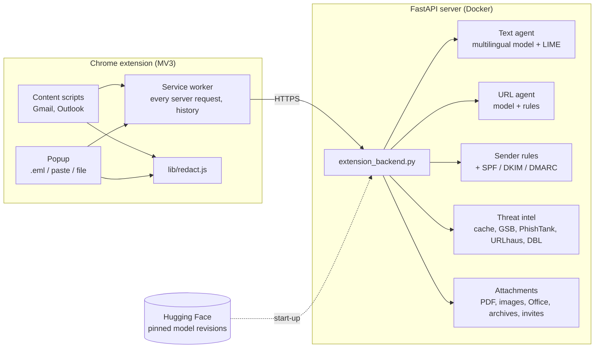
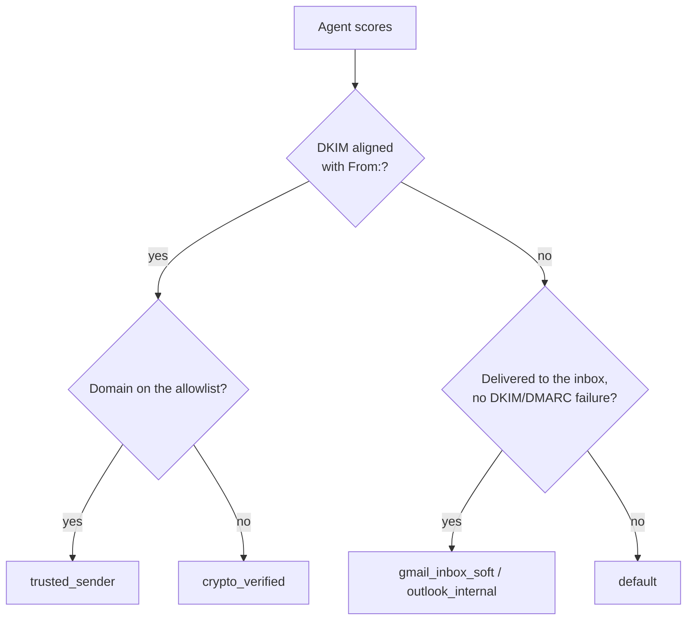
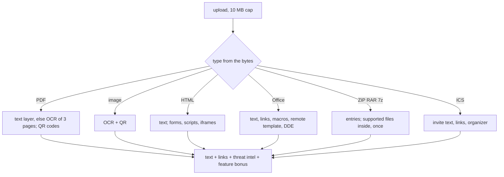

# Architecture

Two parts: a Chrome extension that reads what Gmail or Outlook shows and
draws the verdict, and a FastAPI server that does all the scoring. The
extension never classifies anything itself.

Where to look: the request handling is `backend/extension_backend.py`,
every weight and threshold is in `backend/settings.py`, and the verdict
itself is the pure functions of `backend/fusion.py`. In the extension,
`lib/api.js` is the only way to the server and `lib/gmail_page.js` holds
everything assumed about Gmail's page.

## Why three agents and rules

Text, links and headers fail in different ways, and real bank or
university mail uses the same words as phishing ("verify your
account"). A text model alone flags them. So PhishLens scores the
wording, the links and the sender separately, shows the three scores,
and lets proof about the sender decide how much the wording counts.

The verdict is a weighted sum (text 0.34, links 0.33, sender 0.33)
against a threshold, plus a few signs strong enough to decide on their
own. Which signs count, and how much the text weighs, depends on what is
proven about the sender: the trust path.

## Trust paths

| Path | Text weight | Threshold | Decides on its own |
| --- | --- | --- | --- |
| `trusted_sender` | x0.5 | 0.65 | a Safe Browsing hit |
| `crypto_verified` | x0.5 | 0.65 | a Safe Browsing hit; or every link leading away from the sender's domain with wording at 0.5 or more |
| `gmail_inbox_soft`, `outlook_internal` | x0.6 | 0.62 | a Safe Browsing hit |
| `default` | x1.0 | 0.5 | text or sender at 0.85 or more; links at 0.85 only with a threat-intel hit or a strong link sign (raw IP, `@` before the host, suspicious TLD, file on a public cloud host) |

Each path declares these signs itself (`TrustPath.forcing` in
`settings.py`), and every answer says which one fired (`forced_by`).

Why each rule exists:

- **The discount needs proof.** A From: header can say anything; a DKIM
  signature aligned with it cannot be forged. The allowlist only adds
  to an authenticated sender, never replaces the authentication (until
  2.0, a forged bank address got the softest path).
- **A signature proves the domain, not honesty.** Attackers sign mail
  from their own domains. On `crypto_verified`, a sender none of whose
  links go to its own domain, with phishing-like wording, is flagged
  anyway. Click tracking of known mailing platforms does not count as
  "elsewhere" (`link_alignment.py`).
- **A brand name over another domain is impersonation.** "Chronopost
  <x@qdsodd.us>" loses every softer path and its sender score is at
  least 0.9 (`known_domains.BRANDS`).
- **A forward vouches for the forward only.** Forwarded mail goes to the
  default path, and the original sender is reported.
- **The link model alone is not proof.** The trained URL model scores
  the long tracking links of real newsletters near 1.0; on its own it
  produced every false alarm of the first public benchmark. It decides
  only with a threat-intel hit or a strong sign; links that only go to
  large known sites skip it.
- **The header model is off** (`METADATA_MODEL_ENABLED=0`). It learned
  old corpora and scored modern legitimate headers (ARC, long Received
  chains) near 1.0: 130 of 297 legitimate emails flagged in the 2.0.7
  benchmark. The sender score now comes from rules and the real SPF,
  DKIM and DMARC results.
- **Too little text, no text verdict.** Under 3 words (image-only mail)
  the text agent is left out and links and sender share its weight.
- **Safe Browsing always wins.** A blocklisted link from a trusted
  sender means the account is compromised.

## Attachments

Text and links count 0.5 each, plus a bonus for risky features (capped
at 0.7), against 0.55. The bonus is the point: an attachment often has
little text, and the feature is the whole signal.

| Feature | Bonus | Why |
| --- | --- | --- |
| macros, remote template | 0.45 | how Office droppers run code |
| DDE field, HTML password field, disk image | 0.40 | a command at open time; a login page sent as a file; ISO/IMG files skip the "downloaded file" warning |
| PDF launch action, encrypted archive | 0.35 | runs on open; scanners cannot look inside |
| encrypted document, PDF auto-run, zip bomb | 0.30 | |
| QR code | 0.20 | the link is invisible to text scanners |
| image-only PDF, legacy Office format | 0.10 | evasion, but real scans exist too |

Macros, remote templates, DDE, executables and scripts (directly or in
an archive) and double extensions (`invoice.pdf.exe`) decide on their
own, even from a trusted sender: delivery says nothing about what a
macro does once enabled. Every step has a limit (pages, time, pixels,
uncompressed size), and XML that declares a DOCTYPE is not parsed.

## Text model

Any two-label Hugging Face classifier works; `phishlens_text_agent.json`
next to the weights says how to feed it (normalisation, length,
calibration temperature, its own override threshold), so a new model
needs no code change. The model reads the subject and then the body,
as it was trained: on the body alone it scored missed phishing 10% on
average, against 94% with the subject. `HF_MODEL_REVISION` pins the
exact commit, and `/health` reports it.

The production model is a distilled mmBERT-small: small enough for a
CPU-only server (about 190 ms per email) and multilingual. How it was
built and why each candidate was kept or rejected:
[multilingual-model.md](multilingual-model.md).

## Reports from users

A report is built in the browser: `lib/redact.js` removes names,
addresses, numbers and link paths, the user sees and edits the result,
and confirms before sending. It always goes to PhishLens Cloud, which
redacts it again (`redaction.py`, tested against the same cases) and
keeps it with a random reference and the day only. Reports become
training data only after a human has read them.

## Design decisions

**No build step in the extension.** The code Chrome runs is the code in
the repository, readable by store reviewers and users. The cost is a
manual load order; each file is wrapped in a function, shares one
namespace, and tests load them in manifest order.

**Translations without `chrome.i18n`.** Chrome's mechanism only covers
the languages Chrome supports, which leaves out Hausa.

**LIME on demand.** An explanation costs about 100 model runs, so it is
a second request, cached by the service worker.

**Threat intel ordered by cost.** Local cache, then Google Safe Browsing
(best coverage, daily quota), then PhishTank, URLhaus and Spamhaus,
in parallel with the models.

**Data formats that cannot run code.** Random Forests load from skops
with a type allowlist instead of pickle; Office files are read as ZIP
and XML with `defusedxml`, without libraries that interpret documents.

**No accounts, no stored emails.** The server keeps URL verdicts only;
the scan history stays in the browser.
