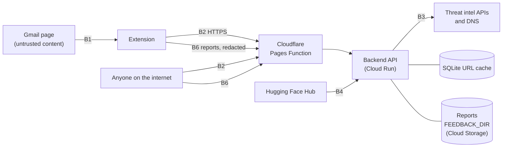

# Threat model

This document covers the PhishLens runtime (Chrome extension, FastAPI
backend, PhishLens Cloud at phishlens.dev). The training pipeline in
PhishingDetector is covered only where it affects the runtime (the
published models). It goes through STRIDE for each trust boundary and
then lists the risks we accept.

## Assets

- The email content sent for scanning: body, sender and attachments,
  all private.
- The correctness of the verdict. A wrong "safe" on a phishing email is
  the main harm the tool can cause.
- The Google Safe Browsing API key and its daily quota. Leaking or
  exhausting it silently removes the strongest URL signal.
- Backend availability, since every extension user on the Cloud setting
  shares PhishLens Cloud.
- The published models on Hugging Face. Every backend loads them at
  startup and the text model decides the wording score.
- The Hugging Face read token (`HF_TOKEN`), needed only when the text
  model sits in a private repository.
- The server and its secrets (Secret Manager for PhishLens Cloud,
  `.phishlens.env` on a self-hosted server). Compromising the host or
  the cloud account exposes everything above.
- The reports users send (`FEEDBACK_DIR`). The text is redacted but
  still private, and it may become training data.

## Trust boundaries

- B1. Email content controlled by the attacker reaches the extension.
- B2. Any HTTP client can reach the public API, not only the extension.
- B3. The backend trusts answers from external intel services.
- B4. The backend downloads and deserialises model files at startup.
- B5. The extension's own interface texts (translations) are shipped
  with the extension and never come from the network.
- B6. Anyone can post a report to `/feedback`, not only the extension.

## STRIDE analysis

Each ID starts with its STRIDE letter: S for spoofing, T tampering, R
repudiation, I information disclosure, D denial of service and E
elevation of privilege. The table gives the main defence; the notes
under it add the details where there are some.

| # | Threat | Boundary | Mitigation in place | Status |
| --- | --- | --- | --- | --- |
| S1 | A forged sender (`From: paypal.com` sent from the attacker's servers) borrowing trust | B1 | Trust comes from DKIM aligned with the From: domain, not from the header text. | Mitigated |
| S2 | A caller claiming `gmail_in_inbox` or `gmail_delivered` to soften its own scan | B2 | The flags only soften the caller's own result, and a Safe Browsing hit still forces phishing. | Accepted (limited impact) |
| S3 | A compromised account at an allowlisted bank sending phishing | B1 | A Safe Browsing hit forces phishing on every path, the allowlist included. | Partially mitigated |
| S4 | An email imitating the mail service's own sender checks ("signed-by: bank.com" in its body, hidden or not) | B1 | Those rows are read only when visible and outside every message body. | Mitigated |
| T1 | A malicious joblib on Hugging Face (pickle runs code on load) | B4 | The agents load from skops files with a type allowlist. | Mitigated |
| T2 | A wrong verdict stored in the reputation cache | B3 | Only the cascade itself writes the cache, keyed by normalised URL, for 24 h. | Mitigated |
| T3 | Wording crafted to push the text model towards "safe" | B1 | A clean text score does not hide a blocklisted URL or failed DMARC. | Partially mitigated |
| T4 | A tampered PhishTank feed, or an entry on a shared host flagging every link of that host | B3 | HTTPS only, and exact-URL matching on shared hosts. | Mitigated |
| T5 | A replaced or wrong text model (`HF_MODEL_REPO` changed, a new revision pushed) | B4 | `HF_MODEL_REVISION` and `HF_AGENTS_REVISION` pin the exact commits. | Mitigated when the revisions are pinned |
| T6 | Fake reports pushing the next model towards wrong labels | B6 | No report is used for training before a person has read and relabelled it. | Mitigated |
| T7 | Content hidden from the reader to steer the checks | B1 | Hidden text and links are moved after the visible ones. | Mitigated (see the note for what is not judged) |
| R1 | No record of what was scanned | B2 | By design: no email content is kept, only aggregate counts on `/metrics`. | Accepted |
| I1 | Users pasting sensitive mail into the PhishLens Cloud test box | B2 | HTTPS only and no storage of bodies; the README warns, and self-hosting is documented. | Mitigated for transport, user choice otherwise |
| I2 | Error messages leaking internals | B2 | Errors return one line and a reference; the stack trace stays in the server log. | Mitigated |
| I3 | Secrets in the repository or its history | n/a | Env files are git-ignored and the Cloud keys live only in Secret Manager. | Mitigated |
| I4 | `/metrics` and `/reputation/stats` revealing traffic and quota use | B2 | Counts only, and `/metrics` is never reachable on PhishLens Cloud. | Mitigated |
| I5 | Personal data the redaction missed in a report | B6 | Redaction twice, then a preview the user edits and confirms. | Partially mitigated (redaction is rule-based) |
| I6 | An API key written to the logs inside an error | B3 | Intel client errors are logged by type and status only. | Mitigated |
| D1 | Request flooding, or burning the 10k/day Safe Browsing quota | B2 | Per-IP rate limits and a tracked quota with a safety buffer. | Partially mitigated (see R6) |
| D2 | Oversized or malformed attachments exhausting CPU or memory | B2 | A 10 MB cap and limits on pages, OCR time and Office part sizes. | Mitigated |
| D3 | ReDoS through crafted headers or URLs | B1, B2 | CodeQL `py/polynomial-redos` is on and its three findings are fixed. | Mitigated |
| D4 | Intel APIs slow or down | B3 | A 3 s timeout per tier, failing open to "no hit". | Mitigated |
| D5 | XML entity expansion or external entities in an Office file | B2 | Parts with a DOCTYPE are skipped and flagged; the rest go through `defusedxml`. | Mitigated |
| D6 | Oversized requests, or inference blocking the server for everyone | B2 | Bodies above 45 MB get 413 and the heavy work runs in a worker thread. | Mitigated |
| E1 | A Gmail page scripting the extension | B1 | No HTML is built from strings; every value becomes a text node or an attribute. | Mitigated |
| E2 | Code execution through a malicious attachment | B2 | Files are parsed, never run, in a container without root. | Mitigated |
| E3 | A compromised dependency or GitHub Action | n/a | Dependabot, a read-only CI token and CodeQL on every push. | Mitigated |
| E4 | CSV formula injection through the history export (a subject such as `=HYPERLINK(...)`) | B1 | Cells starting with `= + - @` get a leading quote, covered by a unit test. | Mitigated |

### Notes on the mitigations

S1. A misaligned `signed-by` stays on the strict path. A brand's name
over another domain's address ("Chronopost <x@random.us>", "PayPal
<x@paypal.xyz>"), look-alike letters and invisible characters included,
cancels the softer paths and raises the sender score
(`test_impersonation_and_links.py`). Authentication-Results is read
clause by clause without comments or quoted strings, and ARC results
alone or a second From: never prove the sender (`test_auth_headers.py`,
`test_extension_backend.py`).

S2 is documented in the `AnalyseRequest` docstring in
`extension_backend.py` (the hints can only change the caller's own
result); the flags never touch shared state. For S3, the allowlist is
small and documented as a regional fallback. For S4, the server writes these rows into a header
only when they are host names (`test_bypass_sender.py`,
`content_scripts.test.js`).

T1. The allowlist covers scikit-learn, NumPy, SciPy and the builtins
only, and pickle is refused unless `AGENTS_ALLOW_PICKLE=1`. For T3, the
three agents are independent and threat intel comes on top. For T4,
the hosts that serve many unrelated users (`bit.ly`,
`storage.googleapis.com`) are listed in `SHARED_PATH_HOSTS`, and on them
the whole domain is never matched.

T5. Weights are loaded through `transformers`, which prefers
safetensors files (data only) when the repository provides them. Each
repository gets its own folder so a switch never mixes models, `/health`
reports the repository, revision, name and settings in use, a warning is
logged when the revisions are not pinned, and only the maintainer can
push to the model repository. T6 also has a rate limit per IP, size and
storage caps and strict validation.

T7. The model reads 256 tokens, so invisible text placed before the
message, or fifty hidden links before the real one, could push the real
content out. Text and links hidden by inline styles (server) or by the
computed style (extension) go after the visible ones. Links are read
with an HTML parser and deduplicated by host first, and link targets
rank before addresses written in the text, one per host first.
`<style>` rules are applied too: simple selectors from an index, others
within a work and time budget of half a second. Words written by
`::before` and `::after` are read, and the server and the extension are
checked against the same cases (`tests/fixtures/hidden_cases.json`).
Rules for phones in `@media` with a width, and text on a background
image, are not judged.

I3. `.phishlens.env` and `.env` are the ignored files, and the history
was rewritten once to remove personal data. I4: the Pages Function in
front of PhishLens Cloud never forwards `/metrics`, the operations guide
shows the same rule for a self-hosted proxy, and PhishLens Cloud also
runs with `METRICS_ENABLED=0`, so its Cloud Run address does not serve
`/metrics` either. I5: redaction runs in the browser and again on the
server, no IP is stored, reports sit in a private folder for at most two
years, can be deleted by reference, and a person reviews them before any
use. I6 matters because PhishTank's key is part of its feed URL; the Safe
Browsing key travels in a header.

D1. The limits are 30 per minute for analyse, 20 for attachments and 15
for explain, and at most 30 links per scan go to Safe Browsing. The
quota is tracked in the process with a 500-request buffer; the count
restarts with the instance, so after a scale to zero it can undercount
that day's use. A link Safe Browsing did not check is never cached as
clean, so an exhausted quota falls back to the other sources without
storing wrong verdicts.

D2. Files are checked by their magic bytes and unsupported types are
rejected with 400. OCR stops after 3 pages with a 10 s timeout each,
images are scaled down and guarded against decompression bombs, and
Office files are capped on part count, uncompressed size (zip bombs)
and part size. D3 was fixed with bounded quantifiers, anchored matches
and `email.utils.parseaddr` instead of a regex, with a regression test on
a 50k-character From: header. D4 lookups run in parallel with inference.
For D6, every field also has a maximum length, and the worker thread
keeps the event loop serving `/health` and other requests.

E1. The content script reads the DOM but never evaluates page content.
Translated texts count as values too, since they can carry the sender or
a file name (`h()` in `lib/dom.js`), a unit test fails on any
`innerHTML`, and host permissions cover only Gmail, Outlook and the
configured backends. E2: pdfplumber, BeautifulSoup and zipfile with
defusedxml do the parsing, macros are detected but never run, and PDF
pages are rasterised by PDFium without JavaScript. E3: Dependabot sends
alerts and weekly updates, and the CI token is limited to
`contents: read`.

## Residual risks and known limitations

### R1. False negatives happen

On 2,000 recent phishing emails nobody had looked at, the whole system
caught 90.2%. New campaigns, and wording written to beat it, will do
worse. PhishLens does not filter mail. It explains its verdict so the
user can judge.

### R2. Some languages are read better than others

The text model was trained on 22 languages but measured on real
phishing in only 6. A self-hosted server uses the English model unless
told otherwise. The link, sender and threat-intelligence checks work the
same in every language ([languages.md](languages.md#text-model)).

### R3. A phishing domain that signs its own mail gets the softer path

DKIM proves who sent the email, not that the sender is honest. Treating
signed senders like unsigned ones catches about 7 points more phishing
but doubles the false alarms on real inbox mail. As a compromise, we
flag a signed sender anyway when all its links lead elsewhere and the
wording looks like phishing. A link to a public file host counts even
next to a decoy link to the sender's own domain. Signed phishing still
gets the discount if it also links to its own domain while the lure
sits on an ordinary site, if it sends no link, or if it goes through
known click tracking ([evaluation](evaluation.md#results)).

### R4. The false-alarm rate rests on 414 legitimate emails

They come from one person's inboxes and from technical mailing lists.
Other inboxes, banks and languages may see more false alarms, and user
reports are how we will find out.

### R5. Any API caller can claim the soft trust signals

We accept this because the effect stays inside that caller's own
response.

### R6. The API is shared and open

There are no accounts. Rate limits are per IP, kept in memory and reset
on restart, which on PhishLens Cloud happens whenever the instance
scales to zero. An attacker can also spread requests over many
addresses. Behind a reverse proxy the limits need the proxy's address in
`FORWARDED_ALLOW_IPS` ([operations](operations.md)), or every user
shares one limit.

The Pages Function in front of PhishLens Cloud replaces any client-sent
`X-Forwarded-For` with the address Cloudflare saw. The backend's own
Cloud Run address is written in that function and is not a secret. It
doesn't need to be, because the backend only answers requests that
carry the function's shared secret (`PROXY_SECRET`). Calling it
directly gets a 403, forged `X-Forwarded-For` or not.

Routes without their own limit (`/`, `/reputation/stats`) share
`RATE_LIMIT_DEFAULT`. `/health` has no limit so the keep-warm job and
uptime monitors can call it. The Safe Browsing quota is shared as well,
so links sent from many addresses can use it up for the day. Per-install
keys or a shared limiter will be worth adding with a public store
release.

### R7. The allowlist trusts authenticated domains, not messages

A compromised account at a listed institution is only caught by threat
intelligence or the link checks. Platforms that send their users' own
words (document shares, invoices, signature requests) stay off the
list, but their signed mail still gets the DKIM-signed discount. Large
sites where anyone can publish a page (notion.so, medium.com,
github.com) skip the trained link model and rely on threat
intelligence. Forms and shared files on large sites (Microsoft Forms,
OneDrive, SharePoint, Google Docs) never count as links to a known site.

### R8. OCR and QR decoding are best effort

Poor scans, stylised fonts and damaged QR codes defeat them. An
image-only PDF still raises the score a little.

### R9. The Hausa interface is a draft

A native speaker still has to review the translation. English stays
available in Settings.

### R10. A long visible preamble still fills the text model's window

The model reads the first 256 tokens. Hidden text is moved after the
visible text, but harmless visible text placed before the lure is read
first. Scoring the end of long emails as well would need a benchmark
run to measure what it costs in false alarms.

### R11. Only the topmost Authentication-Results is read

A server that writes one header per check (Postfix with OpenDKIM and
OpenDMARC) loses the extra results. Such mail can miss a softer path but
never gets a harsher one. Joining them is not safe, because on Gmail the
sender's own headers come right after Gmail's. An uploaded .eml from a
server that adds no Authentication-Results at all shows the sender's
own, if it wrote one. An .eml attached to another email and scanned from
Gmail is read without them.

### R12. Attachments are read, never run

We find addresses that a script writes plainly or hides with escapes,
character codes, percent-encoding or base64. An address computed at run
time is missed, though the script itself is flagged. An Office file that
takes more than 4 seconds to read is reported as not read to the end.
Files attached to a web archive or a saved email inside an archive are
named but not opened, and the same goes for the files held by an Office
document inside an archive.

### R13. Very large emails are only read in part

We parse the first megabyte of an HTML body, leaving out inline images.
Links past that point are still read, the last ones first, but we can't
tell whether they are visible. A flood of more than a thousand links
after the padding can still push some out of the check. Gmail clips such
messages too. Long HTML comments are dropped from the text, and the
links inside them (Outlook's own buttons) are checked as hidden links.

## Review triggers

Revisit this document when an endpoint, an input type or an extension
permission is added, when the text model changes, or when the
deployment runs more than one instance (PhishLens Cloud is capped at
one Cloud Run instance). The last review was for 2.2.0. For 2.1.0 it
started with an external audit of 2.0.12 and went through five rounds
of follow-up on authentication parsing, impersonation, hidden content,
link parsing, the Safe Browsing quota, the Outlook sender, HTML
attachments, HTML comments, rate limits and hosting. Several further
rounds after 2.1.0 covered the interface (caution state, contrast,
keyboard focus), translations, documentation and the removal of unused
code and of the old self-hosted deployment scripts. They added no
endpoint, input type or extension permission.
